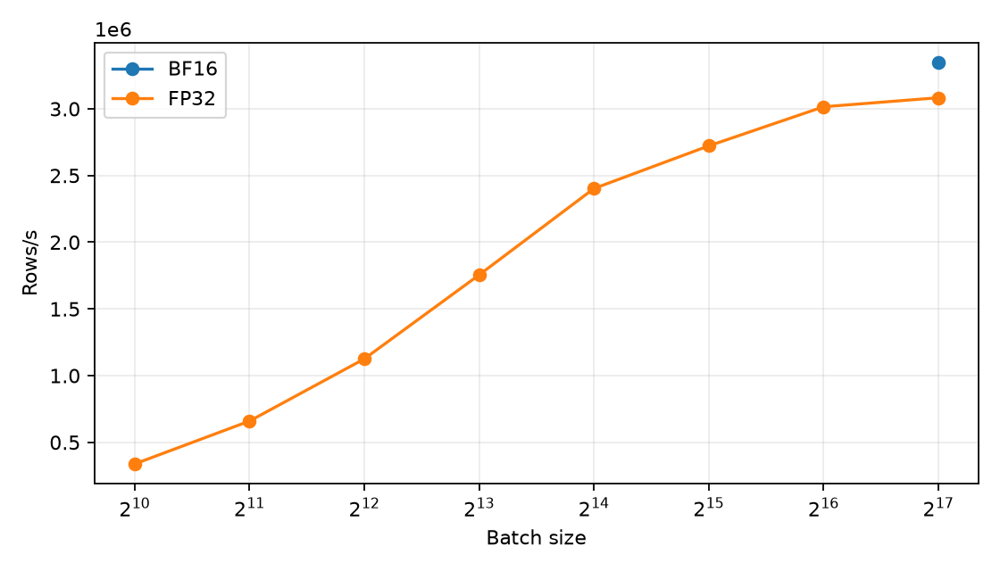
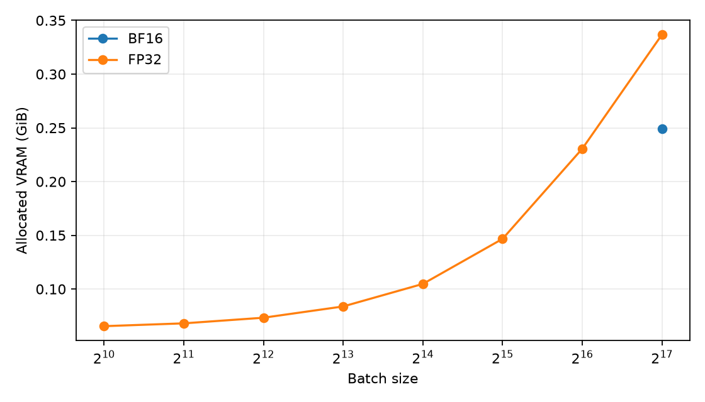
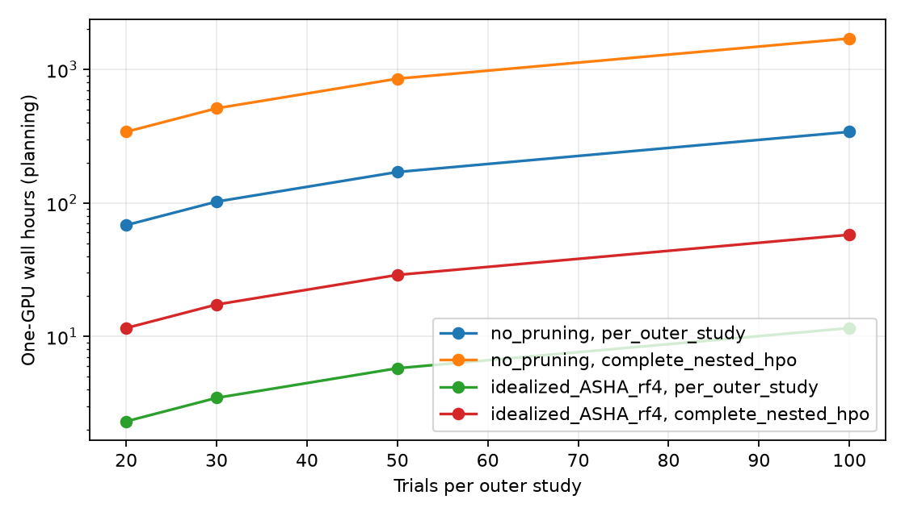

# Checkpoint 6B: local GPU throughput calibration

**Status:** HITL approved and frozen. This is compute calibration on one frozen outer TRAIN population. It did not use outer TEST losses, predictions, Optuna, ASHA, W&B, or model quality to select a setting. No benchmark model was retained. Base commit: `f0cfa1753988e221d456c161aa8650b1de69a014` on `dev`; `origin/dev` matched before edits and the working tree was clean. The accepted 5B fold artifact and 6A methodology were present. `main` was not changed.

## Frozen input representation and training work

The median usable TRAIN count in the committed 5B five-fold summary is fold **3**, with **79,519,698** rows. The benchmark reader emits only rows where `train_eligible_fold_3` is true. Its stream is sorted by frozen tile name. The accepted HITL resolution fixes **33** inputs: the 25 schema columns with role `predictor`, discovered programmatically, followed by exactly eight approved diagnostics. Their ordered names are:

```text
WUIFLAG2020__share__0
WUIFLAG2020__share__1
WUIFLAG2020__share__2
WUICLASS2020__share__High_Dens_Interface
WUICLASS2020__share__High_Dens_Intermix
WUICLASS2020__share__High_Dens_NoVeg
WUICLASS2020__share__Low_Dens_Interface
WUICLASS2020__share__Low_Dens_Intermix
WUICLASS2020__share__Low_Dens_NoVeg
WUICLASS2020__share__Med_Dens_Interface
WUICLASS2020__share__Med_Dens_Intermix
WUICLASS2020__share__Med_Dens_NoVeg
WUICLASS2020__share__Uninhabited_NoVeg
WUICLASS2020__share__Uninhabited_Veg
WUICLASS2020__share__Very_Low_Dens_NoVeg
WUICLASS2020__share__Very_Low_Dens_Veg
WUICLASS2020__share__Water
WATER20__share__0
WATER20__share__1
HUDEN2020
POPDEN2020
OCCHUDEN2020
VACHUDEN2020
VEG2019PC
AWATER20PC
wui_covered_fraction
HUDEN2020__valid_area_fraction
POPDEN2020__valid_area_fraction
OCCHUDEN2020__valid_area_fraction
VACHUDEN2020__valid_area_fraction
VEG2019PC__valid_area_fraction
AWATER20PC__valid_area_fraction
wui_failure
```

No other canonical diagnostic is a model input. For each category, `uncovered_share = 1 - wui_covered_fraction`, and its source-null share is recoverable from covered fraction minus the sum of category shares. For each intensive field, source-null area is recoverable from covered fraction minus valid-area fraction, within canonical tolerance. Excluding those redundant encodings preserves coverage/missingness information and makes later individual-feature attribution easier to interpret. Coordinates, IDs, target diagnostics, and masks are excluded from predictors. This is an approved data representation clarification, not a newly tuned hyperparameter.

The fixed work is a 33-input, two-hidden-layer, width-128 shared ReLU MLP with one BP logit and six FLP logits. The BP loss is soft BCE-with-logits on canonical floating-point BP. The FLP loss is soft categorical cross-entropy on all six canonical probabilities only on `flp_target_valid` rows; no BP weighting, threshold, class conversion, or FLP renormalization occurs. The equal-task objective is `0.5 * mean_BP_loss + 0.5 * mean_FLP_loss`, with separate full-TRAIN support denominators. Benchmark-only AdamW settings are learning rate `1e-3` and weight decay `1e-4`; dropout is zero. Seed is 42. They do not select a scientific model.

## Environment and preprocessing

| Item | Measured value |
| --- | --- |
| GPU | NVIDIA GeForce RTX 5080, 16,303 MiB reported by `nvidia-smi` (17,094,475,776 device bytes) |
| NVIDIA driver | 610.88 |
| CUDA used by PyTorch | 13.0 |
| PyTorch | 2.13.0+cu130, official `cu130` wheel pinned through `uv.lock` |
| Python | 3.12.14 |
| CUDA capability | 12.0 |
| CUDA smoke checks | Device initialization, tensor operation, forward/backward autograd, and BF16 finite loss/gradients passed |

The preprocessing scan fitted statistics only on the 79,519,698 eligible fold-3 TRAIN rows. Fixed `log1p` applies only to `HUDEN2020`, `POPDEN2020`, `OCCHUDEN2020`, and `VACHUDEN2020`. Each numeric missing value receives its observed TRAIN mean after any fixed transform. The other 32 numeric inputs are standardized with TRAIN-only means and standard deviations; `wui_failure` stays binary 0/1. Zero-variance features use a scale of one. The fit streams bounded Parquet batches and never uses outer TEST statistics. The full missing-count vector and fitted statistics are in [`preprocessing.json`](preprocessing.json); the calibration-only state is in the ignored `artifacts/benchmark/06b/` directory.

| Preprocessing measurement | Value |
| --- | ---: |
| TRAIN rows scanned | 79,519,698 |
| Strict FLP-valid TRAIN rows | 57,642,213 |
| Scan time | 25.22 s |
| Effective scan rate | 3,152,857 rows/s |
| Peak process RSS during scan | 0.914 GiB |
| Persisted state | 3,713 bytes |
| State SHA-256 | `7d86676a4ca74e8fd2887d0cf2c7e8c6b8112863fe27b529ab1e42fec12f79b3` |

## Measurement procedure and batch sweep

The CLI `uv run wildfire-training-benchmark` reloads the same deterministic fold-3 TRAIN stream, resets model weights and AdamW at seed 42 for every batch size, warms up **1,048,576** rows, then times **8,388,608** rows. The timed path includes serial Parquet read, fold-TRAIN filtering, preprocessing, CPU-to-GPU transfer, forward pass, both losses, backward pass, finite loss/gradient checks, and optimizer step. CUDA is synchronized around the timed boundary of every step. Batch sizes double from 1,024 to 131,072. The sweep ranks **throughput only**. Peak VRAM is CUDA allocated memory; reserved memory and peak host RSS are in [`batch_throughput.csv`](batch_throughput.csv). GPU utilization telemetry was not measured reliably and is marked unavailable in that file. All sizes succeeded without OOM.

| Batch | Precision | Rows/s | Steps | Wall s | Median step ms | P95 step ms | Peak allocated MiB | Peak reserved MiB |
| ---: | --- | ---: | ---: | ---: | ---: | ---: | ---: | ---: |
| 1,024 | FP32 | 338,142 | 8,192 | 24.81 | 2.7 | 4.0 | 67.0 | 68 |
| 2,048 | FP32 | 659,516 | 4,096 | 12.72 | 2.7 | 4.0 | 69.7 | 90 |
| 4,096 | FP32 | 1,125,624 | 2,048 | 7.45 | 3.0 | 11.5 | 75.1 | 90 |
| 8,192 | FP32 | 1,755,089 | 1,024 | 4.78 | 3.4 | 12.5 | 85.8 | 110 |
| 16,384 | FP32 | 2,402,587 | 512 | 3.49 | 4.5 | 13.9 | 107.3 | 142 |
| 32,768 | FP32 | 2,722,289 | 256 | 3.08 | 13.2 | 17.9 | 150.2 | 190 |
| 65,536 | FP32 | 3,015,443 | 128 | 2.78 | 21.1 | 25.7 | 236.1 | 350 |
| 131,072 | FP32 | 3,083,174 | 64 | 2.72 | 41.5 | 50.1 | 344.9 | 542 |
| 131,072 | BF16 | 3,347,268 | 64 | 2.51 | 38.4 | 46.5 | 254.9 | 542 |

The FP32 curve is near a throughput plateau from 65,536 to 131,072: the largest batch is only about **2.2%** faster than 65,536. BF16 autocast at 131,072 raised measured end-to-end rate by about **8.6%** versus FP32 there, with finite losses and gradients and no runtime error. This is an execution-mode comparison, not predictive-quality evidence. All feasible powers of two are shown above. The technically fastest stable measured benchmark mode was **BF16, batch 131,072**. HITL subsequently froze **BF16 autocast** for RTX 5080 training and validation, and separately froze **{32,768; 65,536; 131,072}** as HPO batch-size candidates. Batch size remains a model-selection dimension; the throughput winner is not the predetermined HPO winner. FP16 is excluded. Fitted preprocessing statistics, stored canonical targets, and metric/report accumulation retain the higher precision required by their existing data contracts.





## Pipeline, full pass, and bottleneck

The separate pipeline measurements use real TRAIN rows. Parquet read plus TRAIN filtering processed 8,448,897 rows at **4.52 million rows/s**; preprocessing of already loaded chunks ran at **12.15 million rows/s**; prepared-tensor GPU training ran at **32.19 million rows/s**; complete sampled BF16 training ran at **3.35 million rows/s**. These rates measure different isolated work and must not be added. Serial Parquet reading/filtering and host-side preparation dominate the end-to-end path; the GPU kernels have substantial unused throughput. The bottleneck is primarily **disk/I/O and host pipeline**, with some transfer/preprocessing overhead, rather than GPU compute or VRAM.

One full streaming pass used the fastest measured mode and consumed exactly **79,519,698** TRAIN rows in **25.23 s** (**3,152,176 rows/s**) across 607 optimizer steps. Peak allocated VRAM was **255 MiB**, peak host RSS **2.29 GiB**. The data-read portion of that pass took **13.28 s**, an effective **5.99 million TRAIN rows/s** when isolated by timer; this includes Parquet decoding, TRAIN filtering, and batch packing. The pass served throughput calibration only; its weights were discarded. Forward-only loss computation on real TRAIN rows in BF16 processed **8,388,608** rows in **2.30 s** (**3,645,231 rows/s**) with **150.5 MiB** peak allocated VRAM. Details are in [`pipeline_breakdown.csv`](pipeline_breakdown.csv), [`full_pass.json`](full_pass.json), and [`forward_only.json`](forward_only.json).

## Frozen 6B execution plan

The 6B HITL direction freezes the following prospective settings. These were chosen from compute calibration and methodological scope, without inspecting model quality:

| Setting | Frozen value |
| --- | --- |
| Model inputs | Exactly the 33 listed above |
| RTX 5080 precision | BF16 autocast for training and validation; no FP16 |
| HPO batch-size candidates | `{32768, 65536, 131072}` |
| Other HPO dimensions from 6A | Hidden depth `{2, 3}`; shared width `{64, 128, 256}`; learning rate log-distributed `[1e-4, 1e-2]`; AdamW weight decay log-distributed `[1e-5, 1e-2]` |
| Maximum resource | 100 epochs; epoch is the resource unit |
| Optuna sampler | Independent `TPESampler(seed=42)` in each outer study |
| Optuna pruner | `SuccessiveHalvingPruner(min_resource=1, reduction_factor=4, min_early_stopping_rate=0)` |
| Pruning comparisons | Epochs 1, 4, 16, 64; a 64-epoch survivor may continue to the 100-epoch cap; no additional 100-epoch pruning rung |
| Trial budget | 30 trials **per outer fold** × 5 independent outer-fold studies = 150 planned trials |
| Worker and venue | One Optuna worker per study (`n_jobs=1`), trials sequential; initially one local RTX 5080 GPU |

Every trial uses the same configuration on five coordinate-only inner spatial folds. At a pruning rung, all five fold models reach that epoch before the trial reports their mean validation `L_tune`; one fold cannot determine pruning. **Every trial reaching a comparison milestone has already incurred that resource cost across all five inner folds before pruning can occur.** Fold models may execute sequentially on the local GPU while retaining independent states between milestones. Each of the five frozen outer TRAIN populations has its **own** HPO study. A configuration selected using one outer fold is not reused as model selection for another fold, because that could let another fold's outer TEST data affect its selection procedure. W&B, if used later, records experiments only. There is no DDP or within-study parallel TPE worker.

The initial venue is local even though the full experiment may be slow. A materially worse observed HPO runtime requires a new HITL decision before moving venue. If a cluster is later approved, assign one whole outer-fold study per GPU and keep `n_jobs=1` within each study.

## Inner-fold and nested-HPO cost planning

Rates below extrapolate the full-pass training rate and forward-only validation rate. Actual inner folds have **not** been instantiated. The model assumes, solely for planning, that each inner fold trains on 80% and validates on 20% of the representative 79,519,698-row outer TRAIN population. It applies that median-fold size to all five outer studies for the complete-experiment approximation; their actual TRAIN counts differ. It charges one full validation pass **per epoch**, which may overestimate validation work if a later implementation validates only at resource milestones. It omits data preparation/state-fit startup, scheduler and filesystem effects, and any difference in trial architecture or batch size.

| Unit or cumulative five-fold milestone | GPU-seconds | GPU-hours / one-GPU wall hours |
| --- | ---: | ---: |
| Train 1 million rows | 0.317 | 0.000088 |
| Validate 1 million rows | 0.274 | 0.000076 |
| Full outer TRAIN epoch equivalent | 25.23 | 0.0070 |
| Approximate inner TRAIN epoch, 80% | 20.18 | 0.0056 |
| Approximate inner validation, 20% | 4.36 | 0.0012 |
| Five-fold 1-epoch milestone | 122.72 | 0.0341 |
| Five-fold 4-epoch milestone | 490.89 | 0.1364 |
| Five-fold 16-epoch milestone | 1,963.56 | 0.5454 |
| Five-fold 64-epoch milestone | 7,854.23 | 2.1817 |
| Five-fold 100-epoch milestone / one unpruned trial | 12,272.24 | 3.4090 |

The frozen ASHA schedule compares at epochs **1, 4, 16, and 64**, with a **100-epoch cap**. The optimistic planning calculation allocates epoch increments of 1, 3, 12, 48, and 36; it assumes only one quarter of trial configurations survive each comparison and reach the next increment. Epoch 100 is a cap, not another pruning rung. This arithmetic uses fractional expected survivor counts and omits scheduler overhead. It is **not a runtime guarantee**. The no-useful-pruning planning case assumes every trial reaches 100 epochs on all five inner folds.

The previous trial-count figures described **one outer-fold HPO study**. The complete nested evaluation requires **five separate studies**, one inside each outer TRAIN population. The complete GPU-hour totals below are exactly five times the per-study estimates, recomputed from the measured full-pass and forward-only rates. On the frozen single GPU, GPU-hours equal local wall-clock hours before overhead.

| Trials per outer study | Complete planned trials | Per-study no pruning h | Per-study idealized ASHA h | Complete five-study no pruning h | Complete five-study idealized ASHA h |
| ---: | ---: | ---: | ---: | ---: | ---: |
| 20 | 100 | 68.18 | 2.31 | 340.90 | 11.56 |
| **30 (frozen)** | **150** | **102.27** | **3.47** | **511.34** | **17.34** |
| 50 | 250 | 170.45 | 5.78 | 852.24 | 28.90 |
| 100 | 500 | 340.90 | 11.56 | 1,704.48 | 57.79 |



If a cluster is later approved, five whole outer studies are the parallel jobs. The table shows the **complete frozen 30-trial-per-study experiment**. “Work lower bound” divides total GPU-hours by the GPU count and is intentionally optimistic; “whole-study schedule” respects `n_jobs=1` and at most five concurrent studies, assuming equal study durations and perfect scheduling. Extra GPUs cannot accelerate one sequential study under this plan.

| GPUs | No-pruning work lower bound h | No-pruning whole-study schedule h | Idealized-ASHA work lower bound h | Idealized-ASHA whole-study schedule h |
| ---: | ---: | ---: | ---: | ---: |
| 1 | 511.34 | 511.34 | 17.34 | 17.34 |
| 2 | 255.67 | 306.81 | 8.67 | 10.40 |
| 4 | 127.84 | 204.54 | 4.33 | 6.94 |
| 5 | 102.27 | 102.27 | 3.47 | 3.47 |
| 8 | 63.92 | 102.27 | 2.17 | 3.47 |

[`cluster_scaling.csv`](cluster_scaling.csv) contains both kinds of estimates for 20, 30, 50, and 100 trials per outer study, and for the per-study and complete-experiment scopes. These ideal bounds exclude shared-filesystem contention, scheduler latency, host differences, GPU-generation differences, synchronization, and unequal study durations. With the frozen one-GPU venue, the full 150-trial experiment is **practical locally but slow**: **17.34 hours** under the optimistic idealized-ASHA allocation versus **511.34 hours** if pruning is ineffective. Actual runtime is unknown before HPO and depends strongly on observed pruning behavior. Model-work runtime is expected to lie between those planning extremes; total wall time can exceed the no-pruning compute estimate because its omitted overhead is positive. No narrower expectation is warranted before HPO observations. The dataset size alone does not justify changing venue.

## Reproducibility, limitations, and next decision

[`configuration.json`](configuration.json) records the measured workload's seed, input order, fold, warm-up and measurement sizes, candidate batches, and timing procedure. [`hpo_execution_plan.json`](hpo_execution_plan.json) separately records the later HITL-directed execution freeze. [`environment.json`](environment.json) records hardware, software, CUDA, and git provenance. [`preprocessing.json`](preprocessing.json) records the TRAIN-only state hash and missing counts. [`batch_throughput.csv`](batch_throughput.csv), [`precision_comparison.csv`](precision_comparison.csv), [`compute_budget.csv`](compute_budget.csv), and [`cluster_scaling.csv`](cluster_scaling.csv) retain unrounded measurements and arithmetic. Wall times are hardware/cache sensitive and need not reproduce byte-for-byte. The small fixed MLP and single fold represent throughput, not all possible HPO configurations or geographic fold sizes. Host-side read timers and isolated pipeline rates are indicative, not a profiler-level attribution of every operation. No GPU utilization percentage is claimed.

Final 6B HITL approval freezes the batch-size candidates, maximum epochs, ASHA settings, trial count, one local GPU, and one sequential worker per study as stated above. No choice was made from validation quality; HPO has not begun. The calibration-pass weights are not scientific model artifacts.
