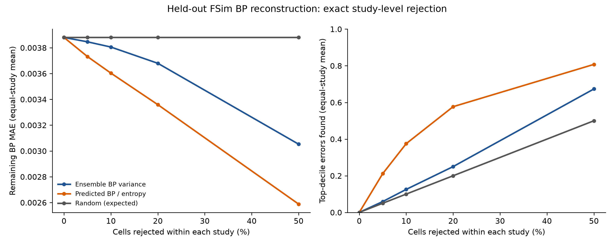
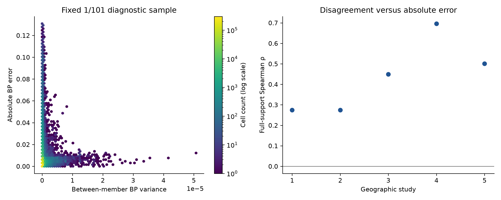

# Phase 10A — uncertainty utility for FSim reconstruction

## Question and scope

Does disagreement among the five Phase 8 ensemble members identify unreliable reconstruction of held-out **FSim burn probability (BP)** beyond the ensemble's predicted BP itself? This is a test of FSim reconstruction, not reliability against real wildfire outcomes. No model, preprocessing state, spatial split, or Phase 9 output was changed.

## Data and definitions

The analysis joined the frozen Phase 9 full-support predictions to canonical BP targets using tile order, `cell_id`, and the five outer TEST fold masks. It checked no TRAIN-eligible rows entered TEST, verified the Phase 9 partition ID hashes and exact support (110,817,231 cells), and reproduced each study's BP MAE within 2 × 10⁻⁷. The Phase 9 manifest hash is recorded in [provenance.json](provenance.json). FLP-valid masks were not altered; this checkpoint evaluates **BP uncertainty utility only**. Phase 9 reports conditional FLP reconstruction separately (mean TV 0.405–0.505 across studies), but its classwise variances are not used here as a BP reliability score.

- **Error:** absolute difference between ensemble mean BP and FSim BP.
- **Disagreement:** population variance of the five member BP probabilities, as exported by Phase 9. Low variance means agreement among these fitted members; it is not calibrated confidence or proof of low epistemic uncertainty.
- **High error:** the largest 10% of absolute errors **within each study**. **Low disagreement:** the smallest 20% of variance values within each study. Exact counts are used; ties at a boundary follow the fixed partition order.
- **Rejection:** remove the largest ranking scores at fixed fractions 0%, 5%, 10%, 20%, and 50%, separately by study. Comparators are predicted BP, Bernoulli entropy of predicted BP, and uniform random rejection in expectation. Risk is remaining BP MAE; detection is recall of the fixed high-error group. No thresholds were chosen to optimize the observed results.

All rejection and failure metrics, plus per-study Pearson and Spearman associations, use full TEST support. Pooled Pearson also uses full support. Pooled Spearman and the disagreement/error density plot use the existing deterministic `cell_id % 101 == 0` diagnostic sample (1,097,262 cells), explicitly because pooled exact ranking is a separate large sort. The sample was not used to select models or thresholds. The within-predicted-BP analysis uses this same sample and ten equal-count predicted-BP bins within each study.

## Results

Full-support disagreement–error Pearson correlations were **0.021, 0.046, 0.089, 0.231, 0.089** in studies 1–5 (pooled: **0.072**). Per-study Spearman correlations were **0.275, 0.274, 0.449, 0.696, 0.501**; sampled pooled Spearman was **0.513**. Thus higher disagreement is associated with error in rank, but correlation alone does not establish useful rejection performance. Predicted-BP Spearman correlations were higher in every study (**0.347, 0.537, 0.680, 0.880, 0.878**).

| Rejected | Disagreement: remaining MAE | BP/entropy: remaining MAE | Random: remaining MAE | Disagreement: high-error recall | BP/entropy: high-error recall | Random: recall |
|---:|---:|---:|---:|---:|---:|---:|
| 0% | 0.00388 | 0.00388 | 0.00388 | 0% | 0% | 0% |
| 5% | 0.00385 | 0.00373 | 0.00388 | 5.9% | 21.2% | 5% |
| 10% | 0.00381 | 0.00360 | 0.00388 | 12.6% | 37.5% | 10% |
| 20% | 0.00368 | 0.00336 | 0.00388 | 25.0% | 57.7% | 20% |
| 50% | 0.00305 | 0.00259 | 0.00388 | 67.3% | 80.8% | 50% |

The table uses an **equal-study mean**, so each geographic study has the same weight. At 10% rejection, disagreement lowers MAE by 3.1% on average, compared with 9.9% for predicted BP. The disagreement ranking is worse than predicted BP on remaining MAE in **all five studies** at every nonzero fraction. At 10%, high-error recall by disagreement versus BP is **7.8% versus 11.7%** (study 1), **16.3% versus 28.3%** (2), **14.0% versus 26.4%** (3), **19.3% versus 50.2%** (4), and **5.3% versus 70.8%** (5). Disagreement even raises remaining MAE in study 1 at 5% and 10% rejection. Its high-error recall is below random in study 1 at 5% and 10% and in study 5 at 5% and 10%. Study 2 has a narrow disagreement advantage in high-error recall at 50% rejection, but still worse remaining MAE than BP.

Every predicted BP is below 0.5. Bernoulli entropy is therefore monotone in predicted BP and produces the **same rejection ranking and table values**, so it is no independent comparator in this data. On the fixed 1/101 sample, rejecting the highest disagreement **within each predicted-BP decile** at 10% changes remaining MAE relative to random rejection within those deciles by **+1.82%, −0.70%, +0.47%, −0.52%, −1.05%** in studies 1–5. Positive means worse. This mixed result gives no consistent evidence of added operational utility after accounting for predicted BP level; it is a diagnostic rather than a fully adjusted full-support estimator.

## Agreement failures

There are **614,188** cells (0.55% of full support) in both the top error decile and bottom disagreement quintile. They account for **2.75% of pooled absolute-error mass**; their study shares range from **0.12% to 4.68%**. Counts by study are **193,365; 174,676; 102,681; 8,939; 134,527**. Studies 1 and 2 contain 59.9% of these cases. All occur at predicted BP below 0.01: 36.6% below 0.001, 28.3% from 0.001 to 0.005, and 35.2% from 0.005 to 0.01. The 0.005–0.01 range has only 25.4% of all cells but 35.2% of these failures. Exact study thresholds, rates, error contributions, and predicted-BP strata appear in the tables below. Some large reconstruction errors have little ensemble spread; agreement must not be read as trustworthy confidence.

## Interpretation and limits

The primary hypothesis has a **descriptive positive association**, but the proposed utility claim is **not supported relative to predicted BP**. Disagreement is only modestly better than random on the equal-study curve and is substantially worse than the simple BP ranking. The conditional sample check is mixed. These results support retaining disagreement as a diagnostic, not using it alone as a reliability gate or claiming calibrated epistemic uncertainty.

The five geographic outer TEST studies are the meaningful reporting units. Their pixels are spatially dependent and the training sets overlap, so pixel-count-based significance tests or confidence intervals would overstate precision. The equal-study comparisons are descriptive; no independent-study significance claim is made. The pooled Pearson and sampled pooled Spearman can reflect geographic differences in both risk and model error. Rejection is an offline triage experiment against FSim targets, not a calibration guarantee for future regions or real fire outcomes. BP and FLP remain distinct conditional prediction tasks.

## Artifacts and reproduction

- [Risk–coverage PNG](risk_coverage.png) and [PDF](risk_coverage.pdf); [disagreement–error PNG](disagreement_vs_error.png) and [PDF](disagreement_vs_error.pdf).
- [Full rejection and high-error table](rejection_performance.csv), [associations](associations.csv), [agreement failures](low_disagreement_high_error.csv), [failure BP strata](failure_by_predicted_bp.csv), [within-BP-decile sample](conditional_bp_deciles_sample.csv), and [conditional sample summary](conditional_summary_sample.csv).
- Run `.venv/bin/python -m wildfire_risk_uncertainty.analysis.phase10a` from the repository root; it reads the frozen Phase 9 exports and writes this directory. The implementation is memory-bounded by one outer study plus the fixed diagnostic sample. Validation: `.venv/bin/pytest -q tests/analysis/test_phase10a.py` and `.venv/bin/ruff check src/wildfire_risk_uncertainty/analysis/phase10a.py tests/analysis/test_phase10a.py`.

For Phase 10B, retain the same five outer studies and examine geographic and feature-missingness patterns of these failures, including simple calibration or residual diagnostics conditioned on predicted BP. Any proposed combined triage rule should be specified without tuning on the existing TEST targets and assessed on separate data or as explicitly exploratory. SHAP, new spatial splits, XGBoost, and geographic-distance experiments remain outside this checkpoint.
