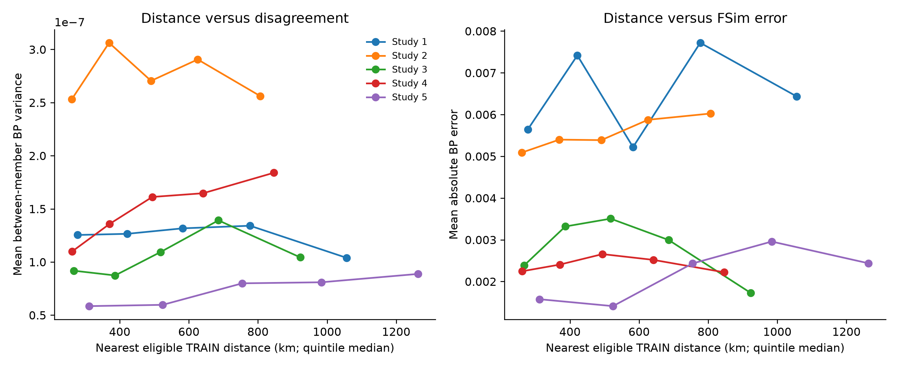
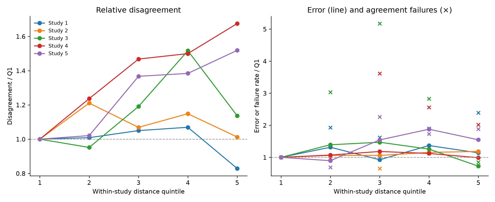
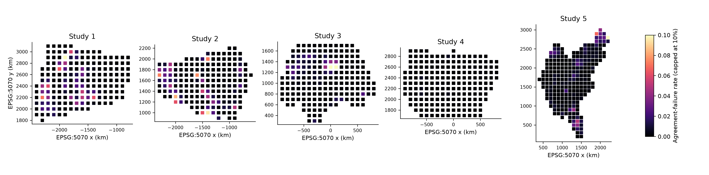

# Phase 10B — geographic separation and uncertainty reliability

## Question and data

Does ensemble BP disagreement increase with distance from eligible training data, and does it warn of growing FSim BP reconstruction error? Phase 10B reuses all **110,817,231** frozen outer TEST predictions from Phase 9, Phase 5B's exact `oof_nearest_training_distance_m`, and Phase 10A's fixed agreement-failure definition. No inference, fitting, checkpoint, split, buffer, or earlier output was changed.

Each prediction tile was joined to its canonical target and Phase 5B distance tile by validated `cell_id`, tile row order, fold membership, and the Phase 9 TEST ID hash. The analysis rejects any TEST row marked TRAIN-eligible, nonfinite distance, or distance at or below the **211.151 km** exclusion radius. It reproduced each Phase 9 BP MAE and the five exact Phase 10A low-disagreement/high-error counts. Results below use full TEST support and are reported by study. FLP is outside this BP reliability analysis.

Distance is Euclidean EPSG:5070 cell-center separation from the nearest **eligible TRAIN** cell. It varies only *beyond* the exclusion radius; the study cannot assess behavior from immediately adjacent cells out to 211 km. Distance is not predictor-space unfamiliarity. Error is `|ensemble mean BP − FSim BP|`; disagreement is the population variance of the five member BP probabilities. Phase 10A agreement failures are exactly the top 10% error cells intersected with the bottom 20% disagreement cells within each study, with fixed partition-order tie handling. Neither error nor FSim BP is available to a deployed warning rule.

## Distance results

Study-specific distance quintiles have equal cell counts. Predicted-BP strata were fixed before this analysis at **[0, 0.001), [0.001, 0.005), [0.005, 0.01), [0.01, 1]**; these are inference-time predictions, unlike target-based diagnostics. The last stratum is sparse or empty in some studies. The table shows full-support rank associations and the ratio of farthest (Q5) to nearest (Q1) quintile means.

| Study | Median distance (km) | Distance–disagreement Spearman ρ | Distance–error Spearman ρ | Q5/Q1 disagreement | Q5/Q1 error |
|---:|---:|---:|---:|---:|---:|
| 1 | 582 | −0.064 | −0.004 | 0.83 | 1.14 |
| 2 | 491 | +0.005 | +0.023 | 1.01 | 1.18 |
| 3 | 518 | +0.043 | −0.039 | 1.14 | 0.73 |
| 4 | 494 | +0.058 | +0.014 | 1.68 | 0.99 |
| 5 | 755 | +0.110 | +0.191 | 1.52 | 1.55 |

Distances range from just over 211 km to **1,547 km**; study 5 has the largest median and upper tail. The equal-study mean Spearman ρ is **+0.030** for distance–disagreement and **+0.037** for distance–error, but these averages obscure opposite study directions. Study 5 is the clearest case where both rise. Study 1 instead has **14% higher error** yet **17% lower disagreement** in Q5 versus Q1. Study 4 has **68% higher disagreement** with essentially unchanged error. Within fixed predicted-BP [0.001, 0.005), study 1's Q5/Q1 error and disagreement ratios are **1.32 and 0.98**; study 2's are **1.56 and 0.81**. These are concrete geographic ranges in which error grows without a matching disagreement warning. Quintile curves are nonmonotone in several studies, so endpoint ratios alone are not trend tests. Full distributions, Pearson and Spearman associations, and BP-stratified quintile means are in the numerical tables.

## Agreement-failure geography and coverage

The **614,188** Phase 10A agreement failures have higher median distance than all TEST cells in every study: **660 vs 582 km** (study 1), **519 vs 491** (2), **542 vs 518** (3), **517 vs 494** (4), and **846 vs 755** (5). Their rates across distance quintiles are not consistently increasing. For example, study 1 rises from **0.56% in Q1 to 1.34% in Q5**, but study 3 peaks at **0.94% in Q3** and falls to **0.15% in Q5**. On average, the failures are underpredictions in studies 1–3; the mean FSim BP versus predicted BP among failures is **0.0323 vs 0.0015**, **0.0232 vs 0.0048**, and **0.0124 vs 0.0008**. Studies 4–5 have much smaller failure rates, and their average failures are overpredictions. These means diagnose FSim reconstruction and are not real fire-event calibration.

Failures are spatially concentrated at the existing 100 km EPSG:5070 map scale. Selecting the **highest-failure-count 10% of bins with at least 1,000 TEST cells after observing the TEST data** captures **53–77%** of failures in those bins across studies while containing about **11–13%** of their TEST cells. This is a descriptive concentration statistic, not an evaluated map-based warning rule. The map caps its color scale at 10% to retain detail; exact rates are in the geographic table. It is not a state or regional attribution map.

Existing model-input coverage fields show no recurring missing-coverage explanation. Incomplete population-density coverage (`POPDEN2020__valid_area_fraction < 1`) occurs in **9.79% of all cells** but only **3.00% of failures**. Incomplete WUI coverage occurs in **0.043% of all cells** and only **7 failure cells**. The canonical WUI failure flag occurs in just three TEST cells and none of the agreement failures. These are descriptive marginal comparisons; coverage and geography can covary, and the full missing-feature mechanism was not modeled. Predicted and reference BP levels, distance-quintile failure rates, coverage conditions, and 100 km bin counts are available in the tables.

## Interpretation and limitations

Phase 10B adds a direct test of a proposed mechanism that Phase 10A did not assess. Geographic separation beyond 211 km does **not** produce a consistent increase in ensemble disagreement, and disagreement does **not** reliably track the geographic error changes. The positive distance association in study 5 is descriptive and does not reverse Phase 10A's finding that predicted BP is the stronger error-ranking baseline. Distance and predicted BP also covary; the fixed BP-stratified results show mixed patterns rather than an independent distance-warning effect.

Cells are spatially dependent, and the five outer studies share parts of their training support. Pixel counts therefore do not supply independent significance evidence. No causal effect of distance, calibrated uncertainty, predictor-space novelty, or real-world wildfire reliability is inferred. The 100 km hot spots are selected and described on the same TEST data, and no new warning rule was optimized or evaluated here.

Additional analysis is justified only for **mechanistic, prespecified diagnostics** of the localized failures, such as checking predictor distributions and target residual structure in identified regions. Any claim that a new geographic or combined uncertainty rule improves warning quality requires independent evaluation beyond these same TEST outcomes. Repeating more threshold searches on this TEST set is not warranted by these results.

## Artifacts and reproduction

- [Distance associations](distance_associations.csv), [distance quintiles](distance_quintiles.csv), [fixed predicted-BP strata](predicted_bp_distance_strata.csv), [failure distance](failure_distance.csv), and [failure summary](failure_summary.csv).
- [Coverage conditions](coverage_conditions.csv), [100 km geographic bins](failure_geography_100km.csv), and [geographic concentration](geographic_concentration.csv).
- [Distance figure](distance_disagreement_error.png), [joint trends](joint_distance_trends.png), and [failure map](agreement_failure_geography.png), each with a matching PDF. [Provenance](provenance.json) records the Phase 9 manifest and fixed definitions.

Run `.venv/bin/python -m wildfire_risk_uncertainty.analysis.phase10b` from the repository root. It reads one geographic study at a time and produces these tables and figures. Validation used `.venv/bin/pytest -q tests/analysis/test_phase10b.py tests/analysis/test_phase10a.py tests/training/test_phase9.py` and `.venv/bin/ruff check src/wildfire_risk_uncertainty/analysis/phase10b.py tests/analysis/test_phase10b.py`.
