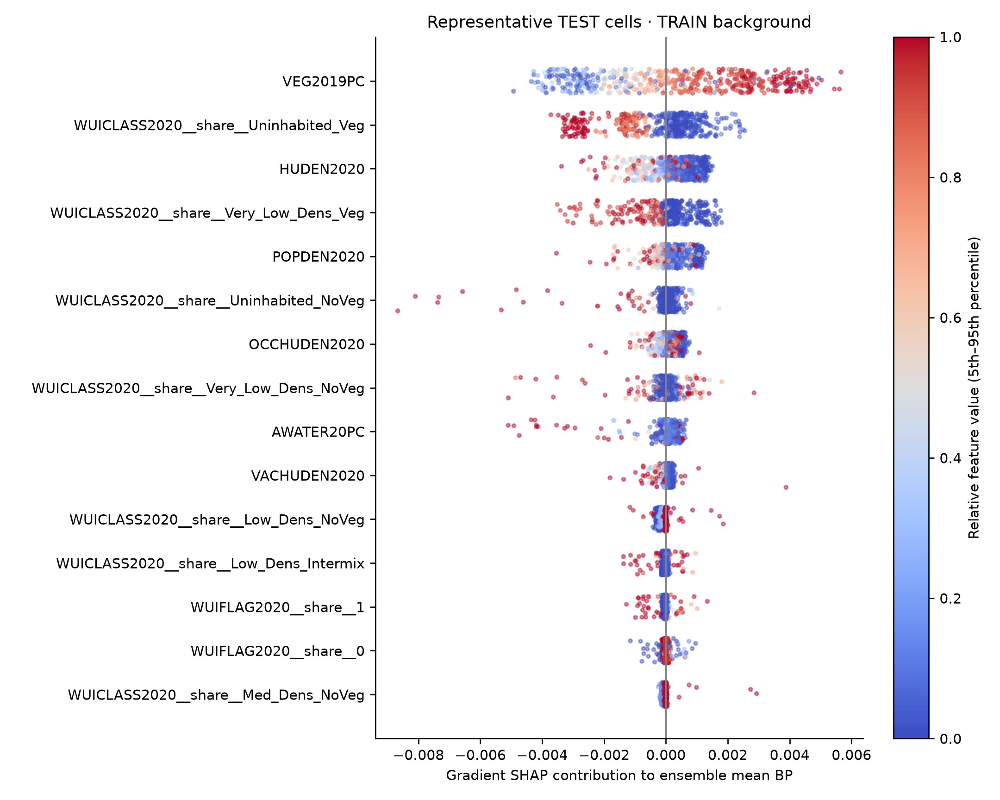
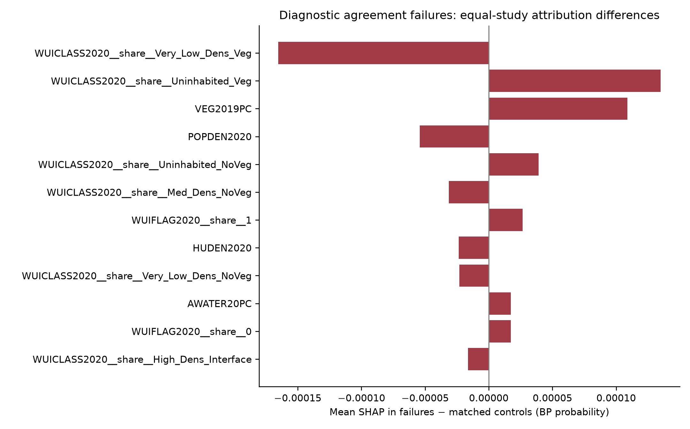

# Phase 10D — BP feature attribution and agreement failures

## Question and finding

What do the frozen five-member neural ensembles use to reconstruct FSim burn probability (BP), and can their attribution patterns characterize high-error predictions on which members agree? On a bounded, held-out diagnostic sample, `VEG2019PC` has the largest mean absolute gradient SHAP attribution in **all five** outer studies. Vegetation-related WUI shares and housing/population density features also rank highly. Independently initialized members have similar importance rankings, including on sampled agreement failures. Failure cases differ from predicted-BP-matched low-error controls in some WUI-share attributions, but the differences are small, vary by study, and do not identify why FSim BP differs. SHAP describes **model behavior relative to a background**. It does not establish causes of reconstruction error, physical wildfire drivers, calibrated confidence, or the absence of epistemic uncertainty.

## Frozen models, inputs, and sampling

The analysis loads the five Phase 8 epoch-100 checkpoints for each geographic study using Phase 9's SHA-256 and metadata checks. The exact 33-feature order comes from the frozen cache manifest and is checked against each study's preprocessing state. Phase 8 fitted those states on eligible outer TRAIN cells only. Four density columns (`HUDEN2020`, `POPDEN2020`, `OCCHUDEN2020`, `VACHUDEN2020`) receive `log1p`; missing values are replaced with TRAIN means; the other continuous columns are standardized with TRAIN statistics; `wui_failure` stays binary and unstandardized. SHAP operates on this **transformed model-input scale**. The exports preserve raw and transformed feature values with original names mapped by index. WUI shares are correlated/compositional, so attribution among related columns can be redistributed by the model and background choice.

Each study uses 128 deterministically sampled eligible TRAIN cells as its SHAP background. Every selected background row is checked against frozen study-specific training eligibility. Held-out examples come from Phase 10C's deterministic 1% outer TEST sample, whose predictions were joined to Phase 9's full-support exports with validated cell IDs. No TEST example enters a background, and no model or preprocessing state was changed.

For each study, the diagnostic set contains 110 randomly selected representative TEST cells, 50 cells from the top predicted-BP decile of that TEST sample, 40 Phase 10A high-error/low-disagreement failures, and 40 low-error controls. One overlap reduces study 5's elevated category to 49, giving **1,199 distinct explained TEST cells** across studies. A failure is in Phase 10A's **top 10% absolute BP error and bottom 20% between-member variance on full outer TEST support**, including exact partition-order handling of ties. To preserve this definition, the code reconstructs Phase 10A's full-support tail masks and maps them by validated cell ID before selecting diagnostic cases; numeric cutoff comparison alone would misclassify some study 2 ties. Controls have at-or-below-median error and are greedily matched without replacement to each failure's predicted BP within its study. Median absolute predicted-BP difference is zero in every study; maximum differences are 0, 0, 0, 0.0000061, and 0.0000366. Matching is diagnostic and does not balance geography, other predictors, or disagreement. Outcome-selected failures and controls must **not** be read as an unbiased TEST sample.

## SHAP computation and validation

GradientExplainer (`shap` 0.54.1) explains a differentiable wrapper that averages the five members' **sigmoid BP probabilities**, using Phase 9's bfloat16 forward path before averaging float32 probabilities. The output scale is BP probability, not log-odds. With 1,024 integration samples per explained cell, the wrapper reproduces stored Phase 9 ensemble probabilities to at most `9.4 × 10⁻¹⁰` in the completed exports. Each attribution is relative to the mean ensemble BP prediction over that study's 128 TRAIN background cells. Positive values raise the modeled BP relative to that baseline; negative values lower it. Gradient SHAP is a Monte Carlo approximation, and bfloat16 rounding adds a small numerical discontinuity.

The 16-cell pilot took **3.67 s** and yielded a mean absolute completeness residual of **0.000066 BP** relative to a mean absolute prediction–background shift of **0.000792 BP**. In the 1,199-cell ensemble run, each study's mean absolute residual divided by mean absolute shift is **4.8–6.1%**; the absolute residuals are 0.000096, 0.000222, 0.000117, 0.000157, and 0.000098 BP. These are approximation errors, so small attribution differences should not be overinterpreted. Five-member explanations took **217 s** of measured explanation time in total; the complete bounded run, including 32 member-specific diagnostic cells per study, finished in about **7 minutes**. The 32 cells comprise the same 16 failures and 16 matched controls for each member, with the same study TRAIN background and probability output scale.

## Global BP attribution

Global importance is the **equal-study mean** of mean absolute SHAP values from the 110 representative TEST cells per study only (`n = 550`). Elevated-risk and outcome-selected cases are excluded from this ranking. All values below are BP probability contributions, relative to each study's TRAIN background.

| Rank | Feature | Mean absolute SHAP |
|---:|---|---:|
| 1 | `VEG2019PC` | 0.002213 |
| 2 | `WUICLASS2020__share__Uninhabited_Veg` | 0.000997 |
| 3 | `HUDEN2020` | 0.000688 |
| 4 | `WUICLASS2020__share__Very_Low_Dens_Veg` | 0.000570 |
| 5 | `POPDEN2020` | 0.000396 |

`VEG2019PC` ranks first in all five studies; its study-specific mean absolute attribution ranges from 0.001589 to 0.003290 BP. The next ranks differ: `AWATER20PC` is second in study 5, while uninhabited/very-low-density vegetation shares matter more in several others. In the representative sample, higher transformed `VEG2019PC` generally accompanies more positive attribution (equal-study mean feature–SHAP Spearman ρ = +0.774). Higher `WUICLASS2020__share__Uninhabited_Veg` generally accompanies more negative attribution (ρ = −0.645). These are descriptive relationships in model explanations; correlated WUI shares, scale, and background choice prevent causal or independent-feature interpretations.

The [ranked importance figure](feature_importance.png) and [top-feature dependence plots](top_feature_dependence.png) show the same representative subset. Every feature's study-specific values and signed/absolute contributions are in [study_feature_importance.csv](study_feature_importance.csv) and [global_feature_importance.csv](global_feature_importance.csv).

## Ensemble-member consistency

On identical diagnostic cells, the median pairwise member Spearman correlation of 33-feature **mean absolute importance ranks** is **0.917, 0.902, 0.919, 0.941, and 0.937** in studies 1–5. Pairwise top-five feature overlap averages **4.0, 4.2, 4.2, 3.7, and 4.1** of five. Thus members often emphasize the same leading features, while lower-ranked attributions and some member-specific ordering vary. Mean signed attribution-vector cosine on the 16 failures is **0.698, 0.876, 0.775, 0.746, and 0.935**; the paired-control values are **0.684, 0.904, 0.864, 0.735, and 0.825**. Failure cases therefore do not show a consistent loss of attribution agreement relative to controls. These results use a small, outcome-selected set and inherit gradient SHAP approximation error. They show shared model behavior, not that the shared behavior is correct or that ensemble agreement is calibrated confidence. Pairwise values and per-member feature ranks are in [member_consistency.csv](member_consistency.csv) and [member_feature_importance.csv](member_feature_importance.csv).

## Systematic error diagnostics

The selected failures in studies 1–3 are all underpredictions: mean FSim BP versus ensemble prediction is **0.0335/0.00132**, **0.0249/0.00471**, and **0.0130/0.00072**. Study 4's 40 cases are 45% underpredictions and study 5's are 32.5% underpredictions. This is a deliberately selected diagnostic set, not an estimate of population prevalence; Phase 10A reports full-support prevalence.

Compared with predicted-BP-matched low-error controls, the largest equal-study *signed* attribution differences are `WUICLASS2020__share__Very_Low_Dens_Veg` (−0.000165 BP), `WUICLASS2020__share__Uninhabited_Veg` (+0.000135), and `VEG2019PC` (+0.000109). These are much smaller than the top features' typical absolute attributions and partly offset because cases were matched on final BP prediction. The very-low-density vegetation-share difference is negative in studies 1–4 but positive in study 5; `VEG2019PC` is negative in study 1 and positive in studies 2–5. `Uninhabited_Veg` is positive in all five, but near zero in studies 3 and 5. Corresponding transformed feature means also differ, yet no selected failure or control has a nonfinite raw input value. There is no single stable attribution signature that accounts for the target residual across studies.

[failure_control_summary.csv](failure_control_summary.csv) gives equal-study differences; [failure_control_attributions.csv](failure_control_attributions.csv) gives per-study signed and absolute SHAP means, transformed feature means, and raw missingness fractions. These comparisons were specified as diagnostics, with no warning rule fitted or evaluated on the same TEST outcomes. A plausible interpretation is that correlated vegetation/WUI inputs can combine to produce nearly the same low predicted BP in cells with very different FSim BP. The present evidence **cannot show** that these inputs cause the underprediction, that changing them would correct it, or that a missing predictor is the explanation. The strong member similarity on failures is consistent with shared representation or shared blind spots, but does not measure total epistemic uncertainty.

## Limits and implications

Gradient SHAP estimates model-output attribution along paths between TEST inputs and a small TRAIN background. Changing the background or grouping correlated predictors can change rankings and signed contributions. The 550 representative cells support a bounded descriptive ranking, not a precise full-support population estimate. Failure/control selection uses held-out outcomes and is exploratory; matched predicted BP does not remove geographic or predictor confounding. Some cells and regions recur across outer studies, and within-study cells are spatially dependent. No pixel-independent significance claim is made. FLP, real wildfire outcomes, causal feature effects, and calibrated epistemic confidence were not evaluated.

Phase 10D adds a **mechanistic description of the frozen model's prediction path** to Phases 10A–10C: the members often rely on similar vegetation, WUI, and density information even when they agree on an inaccurate reconstruction. SHAP does not turn disagreement into a reliable error indicator and does not explain away the documented agreement failures. The next scientifically useful step, if pursued, is a prespecified check of predictor-space support and region-specific residual structure with independent evaluation; further TEST-tuned warning rules are not justified by this analysis.

## Reproduction and artifacts

Run `.venv/bin/python -m wildfire_risk_uncertainty.analysis.phase10d prepare`, then `pilot`, `run`, and `analyze` from the repository root with the frozen Phase 8–10C artifacts available. `pyproject.toml` and `uv.lock` now include SHAP. The ignored, recoverable `artifacts/evaluation/phase10d/phase10d-20261116-v1/` directory contains sampled TEST/background IDs, per-cell ensemble and member attributions, raw/transformed values, completeness residuals, hashes, and timing sidecars. Numerical tables, PNG/PDF figures, and [provenance.json](provenance.json) are in this report directory. Validation includes exact Phase 10A tail-count reproduction, Phase 9 prediction agreement, TRAIN/TEST exclusion, ID/order and feature-order checks, finite attribution/completeness checks, automated tests, and Ruff.
