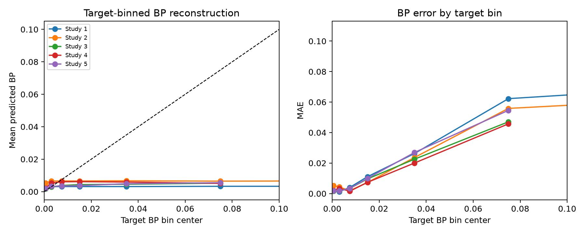
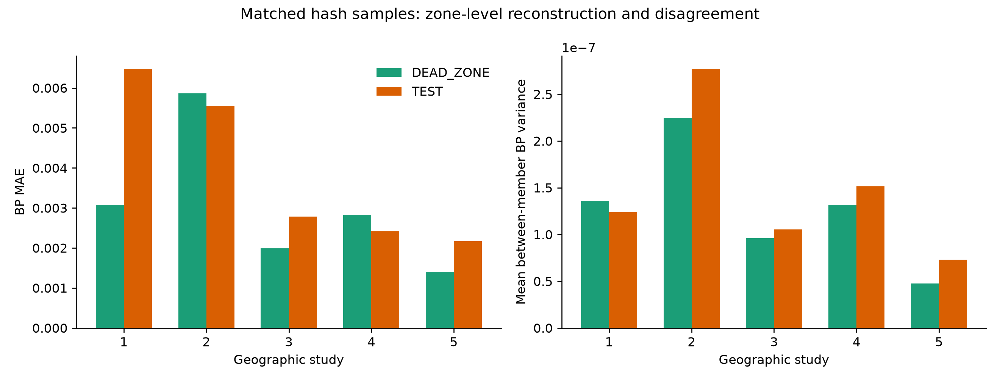

# Phase 10E — synthesis of FSim reconstruction reliability

## Question, design, and evidence populations

Can disagreement among five independently initialized neural networks warn that their reconstruction of FSim's probabilistic wildfire-risk surface is inaccurate, beyond what the predicted burn probability (BP) already tells us? The 33 SILVIS WUI predictors feed five study-specific, five-member ensembles. Phase 9 fixed the checkpoints and evaluation protocol before reading outer TEST outcomes. The five spatial TEST studies are the main units of comparison. The later uncertainty analyses were motivated by Phase 9 and 10A findings; their geographic, buffer-zone, and SHAP diagnostics are exploratory, even where their thresholds and sampling rules were fixed before each analysis.

| Evidence | Population and role |
|---|---|
| [Phase 9 evaluation](phase9_source/README.md) | Full outer TEST support: **110,817,231** BP cells; **81,068,773** FLP-valid cells. Each canonical cell is TEST in one outer study. |
| [Phase 10A](../10a/README.md) and [10B](../10b/README.md) | Full outer TEST support for per-study BP rejection, failure, and distance results. The 10A pooled Spearman and conditional predicted-BP diagnostics use a fixed **1,097,262-cell** `cell_id % 101 == 0` sample. |
| [Phase 10C](../10c/README.md) | Deterministic approximately 1% samples: **418,363** study-specific DEAD_ZONE and **1,109,771** TEST predictions. TEST predictions come from Phase 9. A physical cell can recur in another study's zone. |
| [Phase 10D](../10d/README.md) | **1,199** selected TEST explanations; global rankings use only **550 representative cells** (110 per study). Forty outcome-selected failures and 40 predicted-BP-matched controls per study are diagnostic cases, not prevalence estimates. |

BP error means absolute difference between ensemble mean BP and FSim BP. Disagreement is the **population variance of the five member BP probabilities**. FLP results refer to conditional six-class FSim distributions only where the frozen FLP-valid mask is true; mean total variation (TV) is half the classwise absolute difference summed over six classes. Pooled cell metrics weight cells; an equal-study mean weights the five studies equally. Neither is five independent replications at the pixel level.

## 1. Reconstruction quality

Full-support [Phase 9 performance](phase9_source/performance.csv) shows substantial geographic variation:

| Study | TEST BP cells (million) | BP MAE | BP bias | BP cross-entropy skill versus TRAIN constant | FLP-valid cells (million) | FLP mean TV |
|---:|---:|---:|---:|---:|---:|---:|
| 1 | 19.60 | .006486 | −.004938 | +.0514 | 16.70 | .4578 |
| 2 | 19.59 | .005555 | +.002376 | −.0146 | 16.79 | .4565 |
| 3 | 21.98 | .002786 | −.000415 | +.0226 | 16.89 | .4051 |
| 4 | 22.60 | .002410 | +.002186 | +.1140 | 12.20 | .4186 |
| 5 | 27.04 | .002162 | +.001331 | +.1645 | 18.50 | .5053 |

The **cell-pooled** BP MAE is **.003701**, BP bias **+.000235**, and FLP mean TV **.4515**. Pooled BP R² is **−.00066**; BP cross-entropy skill is positive in four studies and negative in study 2. The ensemble improves on the *average member* for BP MAE, BP cross-entropy, FLP cross-entropy, and FLP TV in all five studies, but never beats the best member's BP MAE or FLP TV. Thus ensembling offers a small average-member gain, not uniformly strong reconstruction. Target-defined BP ≥ .01 cells are underpredicted on average in every study: biases range from **−.00897 to −.02021** on that stratum ([risk strata](phase9_source/risk_strata.csv)). This describes fidelity to FSim in an elevated-reference-risk subset; FSim is not an observed fire outcome. FLP TV of .405–.505 also limits claims about full distribution fidelity; BP disagreement was not validated as an FLP reliability score.

## 2. Does disagreement identify unreliable predictions?

On full TEST support, disagreement–absolute-BP-error Spearman correlations are **.275, .274, .449, .696, .501** across studies 1–5. Predicted-BP correlations are higher in **every** study: **.347, .537, .680, .880, .878** ([associations](../10a/associations.csv)). The positive rank association supports a weak descriptive warning signal, but practical value depends on whether it improves decisions against a simple comparator.

Phase 10A fixed high error as each study's largest error decile and rejected the highest-scored cells at prespecified fractions. At **20% rejection**, equal-study mean remaining MAE is **.00368** for disagreement, **.00336** for predicted BP, and **.00388** for random rejection in expectation. High-error recall is **25.0%**, **57.7%**, and **20.0%**, respectively ([rejection table](../10a/rejection_performance.csv); [risk–coverage figure](../10a/risk_coverage.png)). At **10% rejection**, the mean of five study-specific relative MAE reductions is about **3.1%** for disagreement versus **9.9%** for predicted BP. Predicted BP has lower remaining MAE in all five studies at every nonzero tested rejection fraction. Bernoulli entropy gives the exact same ordering as predicted BP because every predicted BP is below .5. On a fixed 1/101 sample, ranking disagreement *within predicted-BP deciles* gives mixed changes in remaining MAE versus random rejection within those deciles (**+1.82%, −.70%, +.47%, −.52%, −1.05%** by study at 10% within-decile rejection). This does not establish consistent incremental utility after predicted risk.

The fixed intersection of the top error decile and bottom disagreement quintile contains **614,188 cells**, or **.55%** of TEST support, contributing **2.75%** of pooled absolute-error mass ([failure table](../10a/low_disagreement_high_error.csv)). Study-level failure counts range from **8,939** to **193,365**, so this is not uniformly prevalent. These cases demonstrate that fitted members can agree on an inaccurate FSim reconstruction. Low spread among five models cannot be interpreted as calibrated confidence or proof of low epistemic uncertainty. These threshold groups are outcome-defined diagnostics; they are not available as an inference-time warning rule.

## 3. Geography and proximity

Phase 10B examined full TEST predictions only **beyond the 211.151 km TRAIN exclusion radius**. Across studies 1–5, distance–disagreement Spearman correlations are **−.064, +.005, +.043, +.058, +.110**; distance–error correlations are **−.004, +.023, −.039, +.014, +.191** ([distance associations](../10b/distance_associations.csv)). Study 5 has the clearest simultaneous increase, but the directions and sizes are not consistent. In study 1, the farthest distance quintile has **14% higher error** and **17% lower disagreement** than the nearest quintile ([distance quintiles](../10b/distance_quintiles.csv)). Agreement failures have higher median nearest-TRAIN distance than all TEST cells in every study, but their rates across distance quintiles are not consistently increasing ([failure distance](../10b/failure_distance.csv)). Fixed predicted-BP strata also show some rising-error/falling-disagreement contrasts, so changing predicted-risk composition alone does not explain every mismatch. Those strata do not control all geographic and predictor differences.

Phase 10C extended the distance view into previously excluded DEAD_ZONE cells without retraining. The deterministic approximately 1% sample yields DEAD_ZONE/TEST BP MAE pairs **.003081/.006474, .005864/.005551, .001987/.002785, .002831/.002410, .001408/.002173** for studies 1–5 ([study-zone summary](../10c/study_zone_summary.csv)). Accuracy is better near TRAIN in **three studies and worse in two**. Mean disagreement is lower in DEAD_ZONE in four studies, but study 1 combines much lower DEAD_ZONE error with **higher** disagreement; study 2 shows the reverse mismatch. Coarse common predicted-BP-mixture standardization leaves the three-versus-two error direction unchanged ([standardized comparison](../10c/bp_standardized_comparison.csv)). At 20% rejection, equal-study high-error recall for disagreement is **.240** in DEAD_ZONE and **.253** in sampled TEST, versus **.577** and **.576** for predicted BP ([risk coverage](../10c/risk_coverage.csv)). Proximity therefore does not consistently improve either reconstruction or the usefulness of disagreement. This is a comparison of different geographic populations, not a causal distance effect or training without a buffer. Geographic distance is not predictor-space unfamiliarity.

## 4. What attribution adds

Phase 10D's probability-scale gradient SHAP explains the frozen **ensemble mean BP** relative to 128 study-specific TRAIN background cells. In the equal-study importance ranking from 550 representative TEST cells, `VEG2019PC` is first in every study (mean absolute attribution **.002213 BP**), followed overall by the uninhabited-vegetated WUI share (**.000997**) and `HUDEN2020` (**.000688**) ([ranked table](../10d/global_feature_importance.csv); [summary figure](../10d/shap_summary.png)). On identical, small member-specific diagnostic sets, median pairwise 33-feature importance-rank correlations are **.902–.941** across the five studies ([member consistency](../10d/member_consistency.csv)). Members often use similar information.

Predicted-BP-matched failure/control comparisons show small attribution differences whose direction is not stable across all studies. The largest equal-study signed difference is **−.000165 BP** for the very-low-density-vegetated WUI share ([failure/control table](../10d/failure_control_summary.csv)). Study-level member attribution alignment on failures does not show a consistent collapse relative to controls. The selected failures in studies 1–3 are underpredictions, consistent with Phase 9's elevated-reference-BP bias, but selection on error prevents a population inference from these cases. Gradient SHAP's study-level mean absolute completeness residual is **4.8–6.1%** of the mean absolute prediction–background shift; small differences warrant caution. Correlated WUI shares and the TRAIN background affect attributions. SHAP describes how these models arrive at outputs, not which inputs physically cause wildfire risk or why a target residual exists. Shared attribution is compatible with shared model blind spots, but does not establish them as the cause.

## Interpretation and limits

FSim BP and FLP are **probabilistic targets** representing modeled variation in potential fire outcomes; their randomness is not the same quantity as uncertainty about the surrogate model's fitted functions. Five-member BP variance is a limited proxy for that **epistemic** component. Absolute BP error and FLP TV measure **reconstruction relative to FSim**. None of the analyses calibrates ensemble variance into a probability of large error or an error interval. None tests calibration against real wildfire events, including FSim's own real-world calibration. In particular, a low-variance prediction can still be wrong relative to FSim.

The strongest finding is a replicated **association-versus-utility gap**: disagreement is positively related to BP error across all five outer studies, yet predicted BP is consistently better for selective reconstruction at the tested rejection fractions. Geographic analyses show further mismatches between error and disagreement, and attribution shows that members can use similar input relationships on selected failures. These are descriptive results across five related spatial studies, not formal evidence from independent pixels. Spatial dependence, overlapping TRAIN regions, repeated cells across 10C study-zone comparisons, post-Phase-9 exploratory questions, and selection of 10D cases limit generalization. The existing evidence supports a defensible independent-study conclusion about this particular surrogate and comparator; it does not establish a universal verdict on deep ensembles or a calibrated rule for future regions.

Further TEST-tuned warning searches would reuse outcomes already examined. **Prepare the final report now.** If one additional experiment later becomes necessary, prospectively evaluate **calibrated BP reconstruction-error intervals with a simple predicted-BP baseline** on a fresh geographic assessment set after choosing the interval method on development data. This directly tests whether uncertainty can support a coverage decision, and could change the practical conclusion; it is not a Phase 10E result. The ranked alternatives and their data/cost requirements are in [future_work.md](future_work.md). [Advisor summary](advisor_summary.md) and [evidence matrix](evidence_matrix.csv) trace the main claims to source artifacts.

## Validation

The synthesis numbers were reconciled against the cited Phase 9 and 10A–10D CSVs; the Phase 9 pooled row was kept separate from the five study rows. All local Markdown links and evidence-matrix source paths resolve. Existing Phase 9/10A–10D targeted tests pass (**18 passed**), and Ruff passes on their analysis/evaluation modules. Phase 10E adds documentation only and does not alter experimental outputs.

The [Phase 9 source snapshot](phase9_source/README.md), [performance table](phase9_source/performance.csv), [risk-strata table](phase9_source/risk_strata.csv), and [BP figure](phase9_source/bp_reconstruction.png) are byte-identical copies of the corresponding files under the ignored `artifacts/evaluation/phase9/phase9-20261104-v1/` bundle. They make the advisor-facing report portable in Git; the original evaluation bundle remains unchanged.
