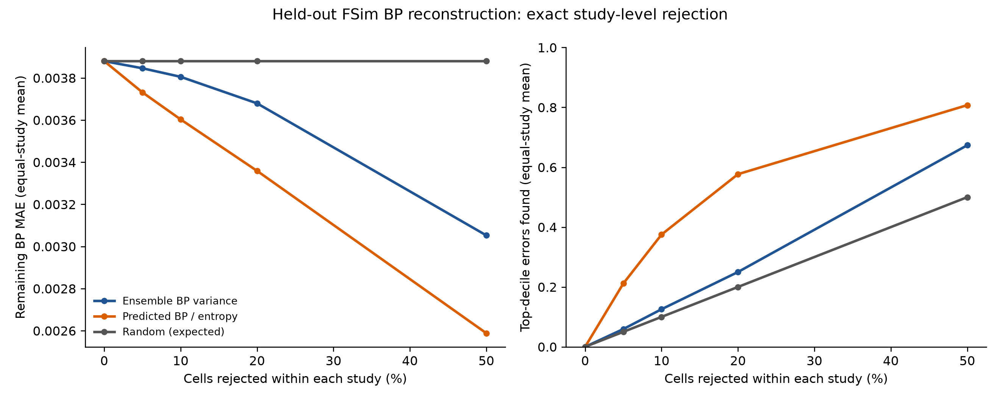

# Research update for advisor — uncertainty and FSim reconstruction

**Discussion length:** 10–15 minutes. **Status:** ongoing independent study; the next experiment and evaluation design are open decisions. This update draws on the [Phase 9 evaluation](phase9_source/README.md) and [Phase 10E evidence synthesis](README.md).

## 1. Motivation and approach (2 minutes)

**Question:** Can machine-learning uncertainty tell us when a prediction should not be trusted? In this study, “wrong” means that a surrogate prediction differs from **FSim's modeled wildfire-risk surface**. It does not mean that FSim or the surrogate is wrong about observed fires.

We trained five geographically evaluated deep ensembles, each with five independently initialized neural networks, using **33 SILVIS WUI predictors** to reconstruct FSim's burn probability (BP) and conditional six-class flame-length probability (FLP) distributions. The frozen spatial design separates eligible TRAIN cells from outer TEST cells by a **211.151 km exclusion radius**. For BP, uncertainty is summarized by the variance of the five member probabilities. This disagreement may reflect part of model uncertainty, but it is not a calibrated probability of error. FSim's probabilistic BP and FLP targets describe modeled fire-outcome variation, a different quantity.

Phase 9 evaluated all **110.8 million** held-out BP cells and **81.1 million** FLP-valid cells across the five studies. BP MAE varies by study from **.002162 to .006486** (cell-pooled **.003701**); conditional FLP mean total variation varies from **.405 to .505**. The ensemble underpredicts the target-defined BP ≥ .01 stratum on average in all five studies. The [Phase 9 reconstruction figure](phase9_source/bp_reconstruction.png) and [performance table](phase9_source/performance.csv) show the geographic variation. All metrics describe fidelity to FSim, not real-world wildfire calibration.

## 2. What the uncertainty experiments found (5–6 minutes)

| Investigation | Main quantitative result | What to show |
|---|---|---|
| **10A: error ranking on full TEST support** | Disagreement–absolute-error Spearman correlation is positive in all five studies (**.274–.696**), yet predicted BP has a higher correlation in every study. Rejecting the highest-disagreement **20%** identifies **25.0%** of each study's largest error decile on an equal-study average; predicted BP identifies **57.7%**, versus **20%** for random rejection. Predicted BP leaves lower MAE than disagreement in all five studies at every tested nonzero rejection fraction. | [Risk–coverage figure](../10a/risk_coverage.png) and [rejection table](../10a/rejection_performance.csv). |
| **10A: agreement failures on full TEST support** | **614,188** cells (**.55%** of TEST support) fall in both the top error decile and bottom disagreement quintile within their study. They contribute **2.75%** of pooled absolute-error mass. | [Failure table](../10a/low_disagreement_high_error.csv). |
| **10B: beyond-buffer distance on full TEST support** | Distance–disagreement Spearman correlations range from **−.064 to +.110**; distance–error correlations range from **−.039 to +.191**. Directions and sizes differ by study. Study 1's farthest distance quintile has **14% higher error** and **17% lower disagreement** than its nearest quintile. | [Joint distance trends](../10b/joint_distance_trends.png). |
| **10C: sampled buffer-zone inference** | On approximately **1%** samples (**418,363 DEAD_ZONE** and **1,109,771 TEST** study-cell predictions), DEAD_ZONE BP MAE is lower in **three** studies and higher in **two**. At 20% rejection, disagreement's high-error recall is **.240** in DEAD_ZONE and **.253** in sampled TEST; predicted BP reaches **.577/.576**. | [Zone comparison](../10c/zone_comparison.png). |
| **10D: sampled SHAP diagnostics** | On **550 representative TEST cells**, `VEG2019PC` has the highest mean absolute BP attribution in every study. Member importance-rank correlations are high (study median pairwise **.902–.941**). Among **40 selected failures and 40 BP-matched controls per study**, attribution differences are small and not consistently directional. | [SHAP summary](../10d/shap_summary.png). |

**Primary figure for discussion:**

**Geographic follow-up:** [joint distance trends](../10b/joint_distance_trends.png) · [buffer-zone comparison](../10c/zone_comparison.png) · **model-behavior follow-up:** [SHAP summary](../10d/shap_summary.png). These reuse existing figures; no new analysis was run for this update.

## 3. Scientific interpretation and competing explanations (2–3 minutes)

The strongest result is the distinction between **association and decision value**. Disagreement rises with error in rank across all five studies, but it is much weaker than predicted BP for identifying the largest reconstruction errors. The within-predicted-BP-decile check is mixed, so we have no consistent evidence that disagreement adds useful ranking information beyond the predicted risk level. Low disagreement means these five fitted models agree; it does **not** imply calibrated confidence or rule out shared model error. The full-support agreement failures make that limitation concrete.

Geographic separation is not a simple explanation: beyond the buffer, error and disagreement do not rise together consistently; nearer DEAD_ZONE cells are not uniformly more accurate. These comparisons are descriptive because geography, target levels, and predictor distributions vary together. SHAP shows shared model behavior on a small diagnostic sample, including selected failures, but it cannot identify the causes of their target residuals or establish that a particular predictor physically drives wildfire risk.

Several explanations remain plausible and competing: (i) the members share an architecture, training targets, and feature representation, producing common blind spots; (ii) predictors may omit aspects of FSim's inputs or represent them at a different spatial scale; (iii) failure regions may be unfamiliar in **predictor space** even when geographically near TRAIN; and (iv) the error-ranking advantage of predicted BP may largely reflect how BP error magnitude varies with target and predicted risk. Existing results do not distinguish these mechanisms. Simple missing-coverage indicators in Phase 10B did **not** show a recurring marginal explanation for agreement failures ([coverage results](../10b/README.md)).

The outer studies share training support, neighboring cells are dependent, and 10C/10D use sampled or outcome-selected diagnostics. We should not treat millions of cells as independent replications. We have not calibrated disagreement into a BP error probability or interval, evaluated a new warning rule on an untouched geographic assessment set, or tested real fire outcomes.

## 4. Prioritized next experiments to decide (2 minutes)

| Priority | Hypothesis and test | Approximate requirements |
|---:|---|---|
| **1. Calibrated BP reconstruction-error intervals** | **Hypothesis:** Adding disagreement to a predicted-BP baseline improves interval coverage at a given width, or improves high-error capture at a fixed rejection budget. Prespecify BP-only and BP-plus-disagreement methods on geographically separate development predictions; compare coverage, width, and selective MAE by study on untouched geography. | **Planning scale:** CPU hours for geographically separated tables and calibration; little model-fitting cost. A genuinely new FSim/WUI geography could use bounded frozen-model inference. If none is available, a new split would require up to **25 ensemble-member refits** and substantial GPU time. |
| **2. Predictor-space support diagnostic** | **Hypothesis:** high-error, low-disagreement cells are farther from eligible TRAIN examples in transformed predictor space even when geographic distance is uninformative. Define scaling and support score using TRAIN only; compare failures and BP-matched controls by study. | **Planning scale:** CPU hours and bounded RAM for sampled approximate-neighbor analysis of cached features; no neural training. A fresh holdout is needed before treating the score as a warning rule. |
| **3. Lightweight learned error estimator** | **Hypothesis:** a prespecified estimator using predicted BP plus disagreement and a small feature set ranks errors better than BP alone, and disagreement contributes incremental value. Fit on genuinely out-of-fold development residuals; assess once on untouched geography with a BP-only ablation. | **Planning scale:** CPU hours for residual-table preparation and a small fit, with little GPU fitting cost; independent geographic assessment has the same data or refit burden as priority 1. This tests a new warning model, not raw variance alone. |

The current Phase 9 TEST outcomes have already informed exploratory diagnostics. Reusing them to optimize and confirm a new warning rule would overstate evidence. The entire current canonical support was assigned to an outer TEST study, so merely relabeling a subset of those evaluated cells would not create an untouched assessment set. The priority decision is whether genuinely new FSim/WUI data are available or a new prespecified spatial split and model refits are warranted. The cost categories above are planning estimates, not measured runtimes.

## 5. Questions for the advisor (1–2 minutes)

1. Is the central claim best framed as **raw ensemble disagreement has limited incremental utility for FSim BP reconstruction**, with the comparison against predicted BP as the primary result?
2. Which practical trust decision matters most next: fixed-budget rejection, high-error detection, or calibrated error intervals? What performance criterion would count as meaningful improvement over BP alone?
3. What independent geographic assessment design is feasible after the five outer TEST studies have already guided exploratory work? Should development and assessment units be spatial blocks rather than cells?
4. Should we prioritize a **decision-oriented calibration test** or a **mechanistic predictor-space diagnostic** first? Which result would most change the research direction?
5. How should we describe the SHAP and geographic findings without overstating causal explanations, epistemic-uncertainty measurement, or real-world wildfire reliability?
