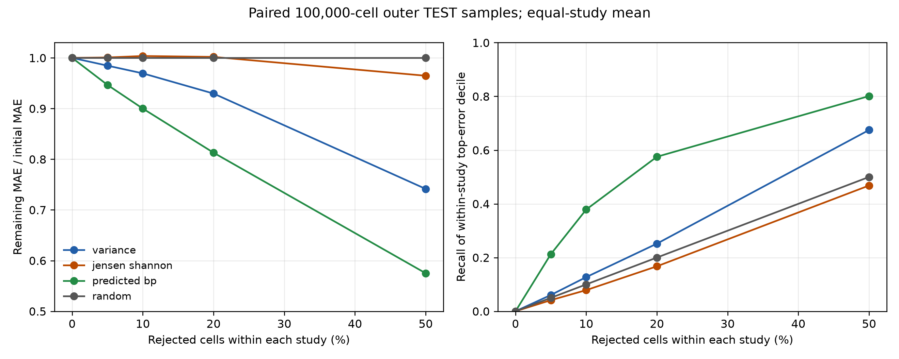
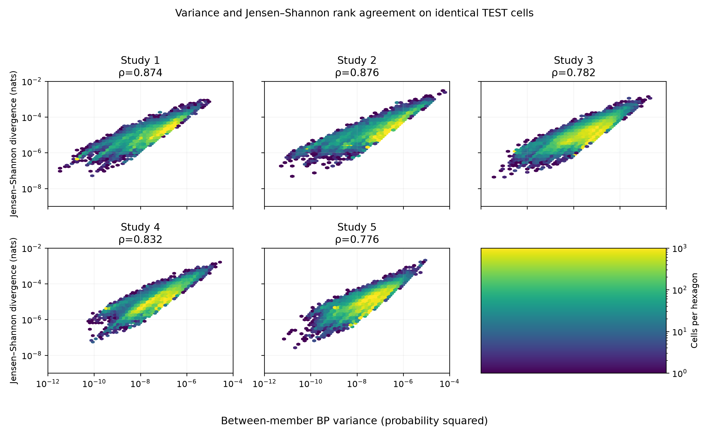

# Phase 11A — comparing deep-ensemble BP disagreement measures

## Question and result

Does Jensen–Shannon (JS) divergence between the five member **Bernoulli BP distributions** identify inaccurate reconstruction of FSim BP better than the raw between-member probability variance used in Phases 9–10? On an outcome-independent, paired sample of **100,000 outer TEST cells in each of five geographic studies**, **no**. JS gives worse remaining MAE than variance in **all five studies at every tested nonzero rejection fraction** (5%, 10%, 20%, 50%). At 20% rejection, equal-study mean top-error-decile recall is **16.7% for JS**, **25.2% for variance**, **57.5% for predicted BP**, and **20% for random rejection in expectation**. The original Phase 10 conclusion survives the change of disagreement measure: positive association does not guarantee useful error detection, and predicted BP remains the much stronger baseline. These are descriptive results on previously studied TEST populations, not independent confirmation of a selected method or calibrated epistemic uncertainty.

## Method and provenance

[Lakshminarayanan et al. (2017)](https://papers.neurips.cc/paper_files/paper/2017/file/9ef2ed4b7fd2c810847ffa5fa85bce38-Paper.pdf), Section 2.4, motivates combining independently trained members; the paper also defines disagreement through member-to-mixture KL divergence. We use the **mean** of those five KL divergences, which is the Bernoulli JS divergence in natural-log nats. Summing instead of averaging multiplies the score by five and leaves every ranking unchanged. For member probabilities `p₁,…,p₅` and mean `p̄`:

`variance = mean[(pᵢ − p̄)²]`, and `JS = H(p̄) − mean[H(pᵢ)] = mean[KL(Bern(pᵢ) || Bern(p̄))]`.

`H(p̄)` alone is **predictive entropy**; JS subtracts mean member entropy and measures their distributional disagreement. Every Phase 9 predicted BP is below 0.5, so predictive entropy has the same rejection ordering as predicted BP in the Phase 10A comparison. Entropy uses stable `xlogy` terms at zero and one; an independent KL calculation agreed with JS within **1.8 × 10⁻¹⁷ nats** on checked sample cells. Zero disagreement means these five fitted members agree, not that the prediction is calibrated or free of epistemic error.

The frozen Phase 9 full-resolution exports contain `bp_mean` and `bp_between_variance`, plus FLP summary columns and cell IDs, **but no member probabilities**. We regenerated the five BP probabilities with the corresponding frozen Phase 8 checkpoints, TRAIN-fitted preprocessing, and Phase 9 inference function. The original 100,000-cell study samples were drawn uniformly without replacement from Phase 10C's independently selected **SplitMix64 approximately 1% outer TEST sample**. Source sample sizes were **196,174; 196,407; 219,658; 226,943; 270,589** in studies 1–5. Both selection stages are independent of BP targets, reconstruction errors, and uncertainty scores, and avoid column-residue sampling. The sample contains unique `(study, cell_id)` keys, validated outer TEST membership, zero study-specific TRAIN eligibility, and exact cache ID/target alignment. Per-study IDs and selection provenance are saved with the predictions.

The 8,192-cell pilot took **0.79 s of inference** and initially matched Phase 9 means and variances within **1.9 × 10⁻¹⁰** and **2.2 × 10⁻¹³**. A few bfloat16 predictions depend on the batch shape used for GPU inference. We reran the affected cells at their original Phase 9 tile batch size rather than accepting a loose tolerance: correction counts were **15, 6, 6, 10, and 408** across studies 1–5. Final maximum mean and variance differences from stored Phase 9 float32 summaries were **3.8 × 10⁻¹⁰** and **1.5 × 10⁻¹²**, respectively. The bounded five-study run took **16.6 s wall time**, including model loading, first-pass inference, corrections, and writes; first-pass inference alone totaled **9.7 s**. The recoverable sampled prediction tables occupy approximately **15 MB**. No model, preprocessing state, split, Phase 9 export, or Phase 10 artifact was changed. [Provenance](provenance.json) records hashes of the Phase 9 evaluation manifest, Phase 8 manifest and 25 checkpoints, sample plans, and outputs.

## Paired evaluation

On the **same 100,000 cells per study**, BP error is `|ensemble mean BP − FSim BP|`. High error is the largest **10% of errors within that sampled study**, fixed before method comparison. Each method rejects its highest-scored 0%, 5%, 10%, 20%, or 50% of cells within the study; score ties break by ascending `cell_id`. Random rejection is its expected MAE and recall. Results below are study-level descriptions; equal-study means give each study one vote. The regenerated variance and saved Phase 9 variance produce identical sampled rejection and association results to displayed precision, so the original Phase 10A method has been reproduced on this paired sample. Sample variance–error Spearman values (**.279, .277, .448, .694, .500**) also closely reproduce Phase 10A's full-support values (**.275, .274, .449, .696, .501**). Sample BP MAEs (**.006450, .005551, .002786, .002412, .002167**) closely match, but do not replace, full-support Phase 9 MAEs ([study summary](study_summary.csv)).

| Study | Spearman error: variance / JS / predicted BP | 20% rejection high-error recall: variance / JS / BP | 20% rejection remaining MAE: variance / JS / BP |
|---:|---:|---:|---:|
| 1 | .279 / .164 / .352 | .189 / .165 / .212 | .006401 / .006570 / .006231 |
| 2 | .277 / .045 / .537 | .308 / .277 / .473 | .005348 / .005546 / .005199 |
| 3 | .448 / .072 / .681 | .270 / .167 / .416 | .002551 / .002825 / .002172 |
| 4 | .694 / .313 / .878 | .370 / .174 / .892 | .002090 / .002316 / .001782 |
| 5 | .500 / −.031 / .879 | .122 / .054 / .883 | .001971 / .002205 / .001394 |
| **Equal-study mean** | — | **.252 / .167 / .575** | **.003672 / .003892 / .003356** |

At 20% rejection, random expectation is **.200 recall** and **.003873 equal-study remaining MAE**. JS is below random on mean recall and slightly worse than random on mean remaining MAE. Its 20% recall is lower than variance in **all five** studies; it is even below random recall in studies 1, 3, 4, and 5. At 5%, 10%, 20%, and 50% rejection, JS's equal-study remaining MAEs are **.003886, .003901, .003892, .003682**, versus **.003839, .003798, .003672, .003038** for variance and **.003723, .003592, .003356, .002582** for predicted BP. The full [association table](associations.csv) includes Pearson coefficients; the [rejection table](rejection_performance.csv) includes every study, method, fraction, MAE, top-error recall, and rejected error mass. Variance and JS are related but not rank-equivalent: their within-study Spearman correlation ranges from **.776 to .876** ([study summary](study_summary.csv)).

## Does JS add information within predicted-BP strata?

Following Phase 10A, we formed **ten equal-count predicted-BP strata per sampled study** using only predictions and cell IDs, with stable tie handling. Within each stratum we rejected the top **10% or 20%** by variance or JS and compared remaining MAE with random rejection in expectation. Positive percentage change means rejection **increased** MAE (worse). The table gives the cell-count-weighted result across a study's ten strata at 10% within-stratum rejection:

| Study | Variance: remaining-MAE change | JS: remaining-MAE change | Random expectation |
|---:|---:|---:|---:|
| 1 | +1.881% | +1.937% | 0% |
| 2 | −0.393% | −0.276% | 0% |
| 3 | +0.507% | +0.607% | 0% |
| 4 | −0.526% | −0.418% | 0% |
| 5 | −1.205% | −1.023% | 0% |

The signs remain mixed across studies; JS is worse than variance in all five within-stratum comparisons. At 10% within-stratum rejection, its mean recall of each stratum's own top error decile is **.076, .136, .083, .133, .142**, versus variance **.079, .140, .085, .164, .169** and random **.100**. This diagnostic does not show useful incremental JS information beyond predicted BP. It is exploratory on previously examined outer TEST populations and is **not** a fully adjusted or independently validated warning policy. [Within-stratum detail](within_predicted_bp_deciles.csv) and [study summaries](within_predicted_bp_summary.csv) retain all counts, boundaries, and metrics.

## Interpretation, limitations, and next use

The primary hypothesis fails on this paired sample: JS does **not** improve reconstruction-error detection over raw variance, is not consistently better than random rejection, and remains much weaker than predicted BP. The result is consistent across all five studies for the **JS versus variance remaining-MAE comparison** at every tested nonzero rejection fraction. It strengthens, rather than reverses, Phase 10A's practical conclusion. JS does not warrant replacing variance as the main error-ranking signal in subsequent experiments. It can still be retained as a clearly labeled distributional diagnostic if a later scientific question specifically concerns member-to-mixture divergence.

A plausible mathematical reason for the poorer ranking is that, when member spread is small, `JS ≈ variance / [2 p̄(1−p̄)]`. This gives a given variance more weight at low predicted BP, while the earlier phases found predicted BP itself to be a strong error-ranking baseline. The approximation suggests a mechanism; this checkpoint did not identify the causes of reconstruction errors. FSim BP is a probabilistic **target**, not an observed fire event; these metrics concern reconstruction relative to FSim, not real-world fire calibration. Member disagreement is an imperfect epistemic proxy, and neither variance nor JS was calibrated into a probability of large error. The five geographic studies have spatially dependent cells and overlapping training support, so 500,000 sampled pixels are not 500,000 independent replications and no pixel-independent significance claim is made. This checkpoint evaluates BP only; it does not compare uncertainty for the conditional FLP distributions.

## Reproduction and validation

The module `wildfire_risk_uncertainty.analysis.phase11a` provides `prepare`, `pilot`, `run`, and `analyze` stages in that order. It reads the frozen Phase 10C TEST hash samples, Phase 9 exports, feature cache, Phase 8 states and checkpoints; output predictions and sample plans are recoverable under `artifacts/evaluation/phase11a/phase11a-20261116-v1/`. The analysis tables, figures, and provenance are in this directory. The pilot gate prevents an unbenchmarked five-study inference run. Automated tests cover JS/KL equivalence and endpoint stability, deterministic sampling, TRAIN exclusion and ID/target alignment, fixed error-group rejection, weighted within-stratum summaries, and completed-artifact moment/provenance integrity. Run `.venv/bin/pytest -q tests/analysis/test_phase11a.py tests/analysis/test_phase10a.py tests/training/test_phase9.py` and `.venv/bin/ruff check src/wildfire_risk_uncertainty/analysis/phase11a.py tests/analysis/test_phase11a.py`.
