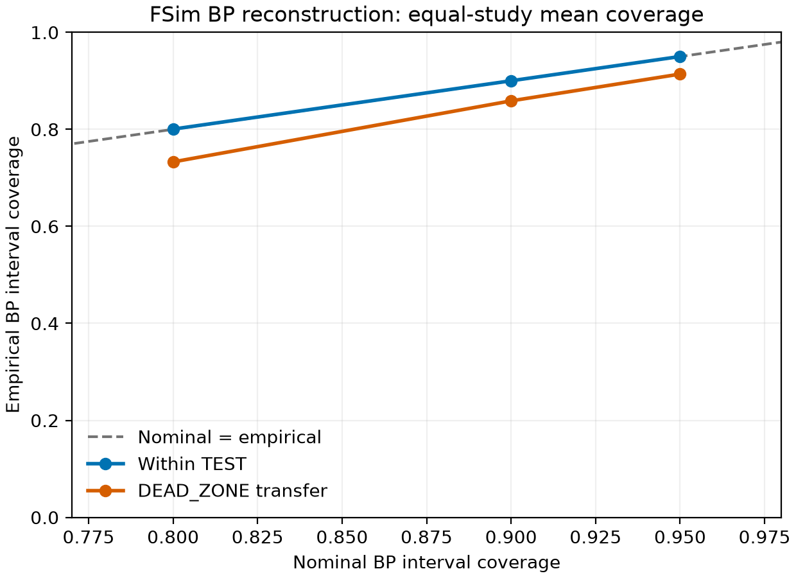
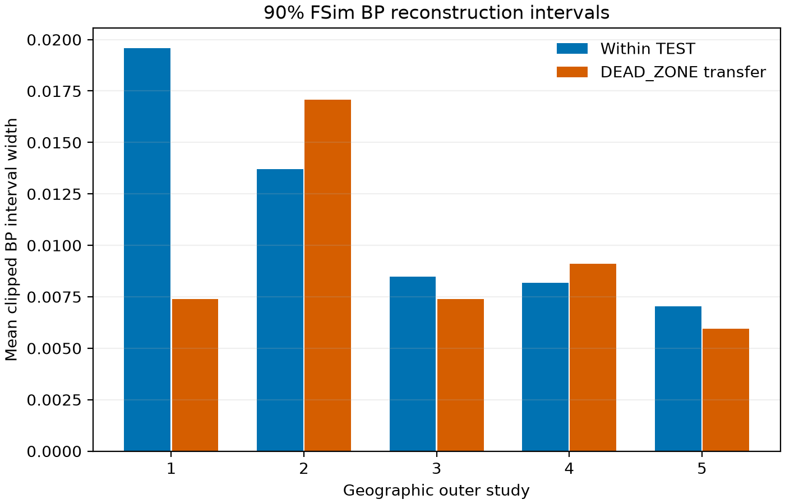

# Phase 11B — split-conformal FSim BP reconstruction intervals

## Method

This exploratory follow-up uses frozen Phase 11A TEST predictions (100,000 sampled cells per geographic study) and Phase 10C DEAD_ZONE predictions. No model is refit. For each study, a seeded outcome-independent permutation places half of the TEST sample in calibration and half in evaluation. The identical TEST evaluation subset is used for both calibration sources. The study-specific DEAD_ZONE sample is the geographic-transfer calibration source. All reported intervals evaluate FSim BP reconstruction, not observed wildfire events.

The nonconformity score is `|BP_FSim − BP_predicted|`. At nominal coverage `c`, with `n` calibration scores, the quantile is the value at one-based rank `ceil((n+1)c)`; a rank above `n` gives infinity. Evaluation intervals are `[max(0, prediction−q), min(1, prediction+q)]`. Primary coverage is 90%; secondary levels are 80% and 95%. Coverage includes both endpoints. Width is `upper−lower`. The central interval score is `width + 2/alpha*(lower−target)` below the interval, or `width + 2/alpha*(target−upper)` above it, where `alpha=1−c`.

Predicted-BP diagnostic strata are fixed from Phase 10C: `[0,.001)`, `[.001,.005)`, `[.005,.01)`, `[.01,1]`. They use predictions available at inference time; per-stratum coverage is descriptive because quantiles were calibrated globally within each study. Equal-study rows average study metrics without pixel weighting; stratum aggregates average contributing studies and report `n_studies`. Spatial dependence and overlapping cells across outer studies limit independence interpretations.

Split conformal's usual marginal coverage statement requires exchangeability of calibration and evaluation examples. Here the within-TEST random split supports an empirical check for this specified sampled TEST design; geographic dependence and alternative regional deployments require care. Conventional exchangeability-based guarantees do not apply to DEAD_ZONE-to-TEST transfer. Clipping retains the target support `[0,1]` and may make widths asymmetric. See [Angelopoulos and Bates](https://arxiv.org/abs/2107.07511) for split-conformal foundations.

## Results

Primary 90% nominal intervals, evaluated on the same held-out TEST half in each comparison:

| Study | Calibration | Calibration n | Evaluation n | Coverage | Mean width | Interval score | Δ coverage | Δ width | Δ score |
|---:|---|---:|---:|---:|---:|---:|---:|---:|---:|
| 1 | within_test | 50000 | 50000 | 0.8967 | 0.019574 | 0.052763 | — | — | — |
| 1 | dead_zone_transfer | 67293 | 50000 | 0.6988 | 0.007396 | 0.084579 | -0.1979 | -0.012178 | +0.031816 |
| 2 | within_test | 50000 | 50000 | 0.9026 | 0.013694 | 0.029896 | — | — | — |
| 2 | dead_zone_transfer | 93909 | 50000 | 0.9553 | 0.017073 | 0.029642 | +0.0527 | +0.003379 | -0.000254 |
| 3 | within_test | 50000 | 50000 | 0.8996 | 0.008482 | 0.020277 | — | — | — |
| 3 | dead_zone_transfer | 93282 | 50000 | 0.8498 | 0.007399 | 0.021464 | -0.0497 | -0.001083 | +0.001186 |
| 4 | within_test | 50000 | 50000 | 0.9001 | 0.008189 | 0.010216 | — | — | — |
| 4 | dead_zone_transfer | 103871 | 50000 | 0.9535 | 0.009116 | 0.010041 | +0.0533 | +0.000927 | -0.000175 |
| 5 | within_test | 50000 | 50000 | 0.9015 | 0.007040 | 0.013099 | — | — | — |
| 5 | dead_zone_transfer | 60008 | 50000 | 0.8359 | 0.005936 | 0.014455 | -0.0656 | -0.001104 | +0.001356 |
| all | within_test | — | 250000 | 0.9001 | 0.011396 | 0.025250 | — | — | — |
| all | dead_zone_transfer | — | 250000 | 0.8587 | 0.009384 | 0.032036 | -0.0414 | -0.002012 | +0.006786 |

Full results: [coverage comparison](coverage_comparison.csv), [coverage by predicted BP](coverage_by_bp.csv), and [provenance](provenance.json). The tables are descriptive; no test of causal geographic effects or real-world risk calibration is implied.

## Interpretation and limitations

Compare the two calibrations study by study: transfer may change coverage, width, and interval score because the residual distributions differ. Within-TEST marginal coverage does not imply conditional coverage within BP strata, reliability on a new geographic region, or calibrated probabilities of model error. DEAD_ZONE cells were excluded from each study's TRAIN data; they are not a model trained without a spatial buffer. FSim supplies probabilistic targets, while these intervals quantify reconstruction error relative to those targets. Cross-study samples can repeat physical cells and are not independent replications.

## Reproducibility

Run `.venv/bin/python -m wildfire_risk_uncertainty.analysis.phase11b --seed 11012` from the repository root. Input hashes, checkpoint/preprocessing provenance, split ID digests, exact sample sizes, and method definitions are in [provenance.json](provenance.json). The script reads one study at a time and never performs neural-network inference. If a source artifact or frozen cache alignment check fails, it stops before reporting results.
